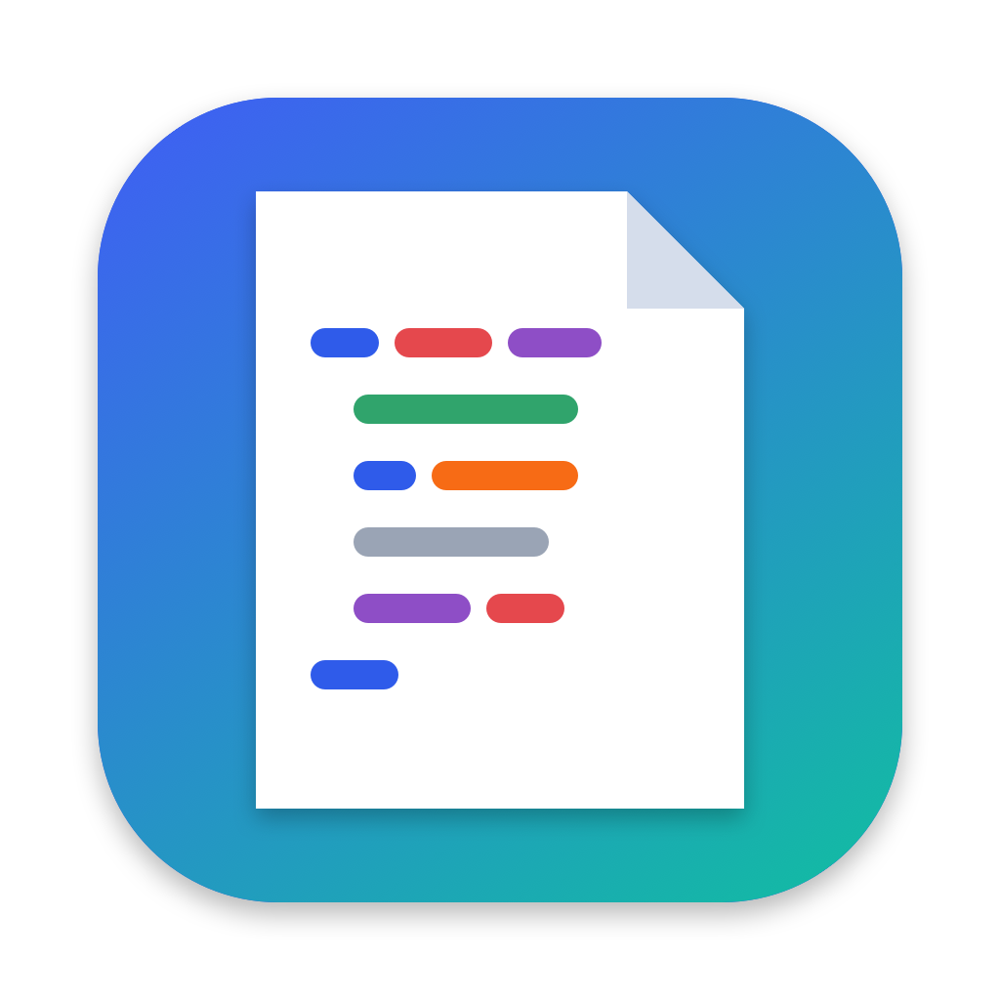

# MacPad

A lightweight, native macOS text editor inspired by Notepad++.



**[⬇ Download the latest release](https://github.com/DH0902/MacPad/releases/latest)** (macOS 13+, Apple Silicon and Intel).

## Features

- **Files:** New, Open, Save, Save As, Open Recent and Revert. The original encoding (UTF-8, UTF-16, Windows-1252, Latin-1) and byte-order mark are kept when saving.
- **Find & Replace** (⌘F / ⌥⌘F): plain text or regular expressions, with `$1` groups and `\n` / `\t` in replacements. Also Count, Replace All and wrap-around.
- **Pretty Print** XML (⇧⌘P) and JSON (⇧⌘J). JSON keeps your key order.
- **Syntax colouring** for XML and JSON, including bold and italic, in light and dark mode. The Language menu overrides the automatic detection.
- **CSV Lint** (⇧⌘L): checks quoting, field counts, blank lines and header names. Click an issue to jump to it.
- **Compare:** side-by-side diff against another open document, a file, or the saved version.
- **Zoom** (⌘= / ⌘- / ⌘0), word wrap, and full **Undo/Redo**.
- **Keyboard Shortcuts** window (⌘/).

## Build and run

You need macOS 13 or later and the Swift toolchain, from either Xcode or the Command Line Tools (`xcode-select --install`).

```sh
./build.sh          # builds MacPad.app (universal: Apple Silicon + Intel)
open MacPad.app
./test.sh           # runs the unit tests
```

`build.sh` signs the app ad hoc. To sign it for distribution, set `SIGN_IDENTITY="Developer ID Application: …"` before running it.

## Installing a downloaded release

1. Download `MacPad-x.y.zip` from [Releases](https://github.com/DH0902/MacPad/releases/latest), unzip it and move `MacPad.app` to **Applications**.
2. The app isn't notarized by Apple, so the first launch is blocked. Open **System Settings → Privacy & Security**, scroll down and click **Open Anyway**. Alternatively, run `xattr -dr com.apple.quarantine /Applications/MacPad.app` in Terminal.

## Project layout

| Path | Contents |
|---|---|
| `Sources/MacPadCore` | Pure, unit-tested logic with no AppKit: file encoding, formatters, CSV linter, line diff, search, syntax tokenizer |
| `Sources/MacPad` | The AppKit app: `App` (entry point and menus), `Document`, `Editor` (highlighting and preferences), `Panels`, `Support` |
| `Tests/MacPadCoreTests` | Swift Testing suites for `MacPadCore` |
| `Resources` | `Info.plist`, sandbox entitlements and the app icon (regenerate it with `swift Scripts/make-icon.swift`) |

## Security

- **App Sandbox and hardened runtime:** MacPad can only access files you open or save through the system panels.
- **XML parsing:** external entities and DTDs are never loaded (XXE protection).
- **User-supplied regex:** every search runs under a time limit, so a slow pattern can't freeze the app.
- **Large files:** files over 256 MB are refused, and syntax colouring is skipped above 5 MB.

## License

[PolyForm Noncommercial 1.0.0](LICENSE.md). You are free to use, modify and share MacPad for **non-commercial** purposes, as long as you keep the `Required Notice` line (the author's copyright) with every copy. Commercial use needs separate permission from the author.

Because it forbids commercial use, this is a *source-available* license, not an OSI-approved "open source" one.
